# Krista UI Agent Extension - Architecture Document

**Version:** 1.0.0-rc2.8  
**Last Updated:** 2026-02-03  
**Framework:** Krista 4.0  
**Status:** ✅ Production Ready

---

## Table of Contents

1. [System Overview](#system-overview)
2. [High-Level Architecture](#high-level-architecture)
3. [Component Architecture](#component-architecture)
4. [Communication Architecture](#communication-architecture)
5. [Request Flow Diagrams](#request-flow-diagrams)
6. [Session Management Architecture](#session-management-architecture)
7. [File Handling Architecture](#file-handling-architecture)
8. [Security Architecture](#security-architecture)
9. [Deployment Architecture](#deployment-architecture)
10. [Data Flow Diagrams](#data-flow-diagrams)

---

## System Overview

### Purpose

The **Krista UI Agent Extension** enables AI-powered browser automation within the Krista platform. It allows users to automate web interactions using natural language commands, supporting both single-command execution and multi-step interactive sessions.

### Key Capabilities

- **Natural Language Automation** - Execute browser tasks using plain English
- **Multi-LLM Support** - OpenAI GPT-4, Google Gemini, Anthropic Claude
- **Interactive Sessions** - Maintain browser state across multiple commands
- **File Handling** - Automatic downloads, screenshots, and media server integration
- **Validation Framework** - Post-execution verification with screenshots
- **Session Profiling** - Performance metrics and execution traces

### Technology Stack

| Layer | Technology | Purpose |
|-------|-----------|---------|
| **Extension Runtime** | Java 21 | Krista platform integration |
| **Framework** | Krista 4.0 | Extension framework |
| **Message Broker** | Apache Artemis Core | AMQP 1.0 messaging |
| **Serialization** | Google Protobuf | Type-safe message encoding |
| **Service Runtime** | Node.js 20.14.0 | Browser automation service |
| **Browser Engine** | Playwright | Chromium/Firefox/WebKit automation |
| **LLM Integration** | OpenAI/Gemini/Claude APIs | AI-powered automation |

---

## High-Level Architecture

### System Context Diagram

```mermaid
graph TB
    subgraph "Krista Platform"
        User[User/Conversation]
        KP[Krista Platform Core]
        MS[Media Server]
    end
    
    subgraph "UI Agent Extension"
        Ext[KristaUiAgentExtension<br/>Java 21]
        IA[InteractionArea<br/>Catalog Requests]
        EH[EventListenerHandler<br/>WAIT_FOR_EVENT]
        RC[UiAgentRawClient<br/>Google Protobuf]
        SM[SessionManager<br/>State Tracking]
        FH[FileHandlingService<br/>File Processing]
    end
    
    subgraph "Message Broker"
        AMQ[Apache Artemis<br/>Port 61616]
        RQ[Request Queue<br/>krista-ui-agent-1-IN]
        RSQ[Response Queue<br/>ext-{id}-OUT]
    end
    
    subgraph "UI Agent Service"
        NS[Node.js Service]
        PW[Playwright]
        LLM[LLM APIs<br/>OpenAI/Gemini/Claude]
        BR[Browser<br/>Chromium]
    end
    
    User -->|Natural Language| KP
    KP -->|Catalog Request| IA
    IA -->|WAIT_FOR_EVENT| EH
    EH -->|Build Request| RC
    RC -->|AMQP Message| RQ
    RQ -->|Consume| NS
    NS -->|Automation| PW
    PW -->|Control| BR
    NS -->|AI Processing| LLM
    NS -->|Response| RSQ
    RSQ -->|Receive| RC
    RC -->|Parse| EH
    EH -->|Process Files| FH
    FH -->|Upload| MS
    EH -->|Publish Event| KP
    KP -->|Display Result| User
    
    style Ext fill:#e1f5ff
    style NS fill:#fff4e1
    style AMQ fill:#f0f0f0
    style BR fill:#e8f5e9
```

### Architectural Layers

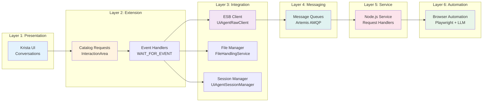

### Design Principles

1. **Separation of Concerns**
   - Java extension handles Krista integration
   - Node.js service handles browser automation
   - Clear boundaries between layers

2. **Asynchronous Communication**
   - AMQP message queues for request/response
   - Non-blocking operations
   - Correlation IDs for request tracking

3. **Type Safety**
   - Google Protobuf for schema validation
   - Compile-time type checking
   - Version compatibility

4. **Scalability**
   - Stateless design with session affinity
   - Horizontal scaling via multiple service instances
   - Queue-based load distribution

5. **Reliability**
   - Correlation IDs for request/response matching
   - Timeouts and error handling
   - Session TTL and automatic cleanup

---

## Component Architecture

### Component Diagram

```mermaid
graph TB
    subgraph "KristaUiAgentExtension"
        direction TB
        Main[Main Extension Class<br/>@Extension]
        Inv[Invoker<br/>Platform Context]
        Attr[ExtensionAttributes<br/>Configuration]
    end

    subgraph "Catalog Requests"
        direction TB
        IA[InteractionArea<br/>@Domain]
        CR1[Single Command Mode<br/>@CatalogRequest]
        CR2[Start Interactive Session<br/>@CatalogRequest]
        CR3[Execute Session Steps<br/>@CatalogRequest]
        CR4[End Interactive Session<br/>@CatalogRequest]
    end

    subgraph "Event Processing"
        direction TB
        EH[UiAutomationEventListenerHandler<br/>@Service]
        WFE[WAIT_FOR_EVENT Pattern<br/>Async Processing]
    end

    subgraph "ESB Integration"
        direction TB
        RC[UiAgentRawClient<br/>Singleton]
        Conn[Artemis Connection<br/>ServerLocator]
        Prod[Message Producer<br/>ClientProducer]
        Cons[Message Consumer<br/>Per-Request]
    end

    subgraph "Session Management"
        direction TB
        SM[UiAgentSessionManager<br/>@Service]
        SI[SessionInfo<br/>State Tracking]
        SK[SessionKey<br/>Conversation + Name]
    end

    subgraph "File Handling"
        direction TB
        FH[FileHandlingService<br/>@Service]
        FR[FileRepository<br/>Media Server]
        HTTP[HTTP Client<br/>Downloads]
    end

    Main --> Inv
    Main --> Attr
    Main --> IA
    Main --> EH
    Main --> RC

    IA --> CR1
    IA --> CR2
    IA --> CR3
    IA --> CR4

    CR1 --> EH
    CR2 --> RC
    CR3 --> RC
    CR4 --> RC

    EH --> RC
    EH --> SM
    EH --> FH

    RC --> Conn
    RC --> Prod
    RC --> Cons

    SM --> SI
    SM --> SK

    FH --> FR
    FH --> HTTP

    style Main fill:#e1f5ff
    style IA fill:#fff4e1
    style EH fill:#f3e5f5
    style RC fill:#e0f2f1
    style SM fill:#fce4ec
    style FH fill:#e8f5e9
```

### Component Responsibilities

| Component | Responsibility | Key Methods |
|-----------|---------------|-------------|
| **KristaUiAgentExtension** | Main extension lifecycle, ESB initialization | `invokerLoaded()`, `invokerUnloaded()`, `invokerRemoved()` |
| **InteractionArea** | Catalog request handlers | `executeSingleCommand()`, `startInteractiveSession()`, `executeInteractiveSessionSteps()`, `endInteractiveSession()` |
| **UiAutomationEventListenerHandler** | WAIT_FOR_EVENT processing, file handling | `handleEvent()`, `buildUserConfiguration()`, `processFiles()` |
| **UiAgentRawClient** | AMQP communication, protobuf serialization | `executePrompt()`, `startSession()`, `executeSession()`, `closeSession()` |
| **UiAgentSessionManager** | Session state tracking | `createSession()`, `updateSessionState()`, `closeSession()` |
| **FileHandlingService** | File downloads and media server uploads | `processFiles()`, `processFile()` |

---

## Communication Architecture

### AMQP Message Flow

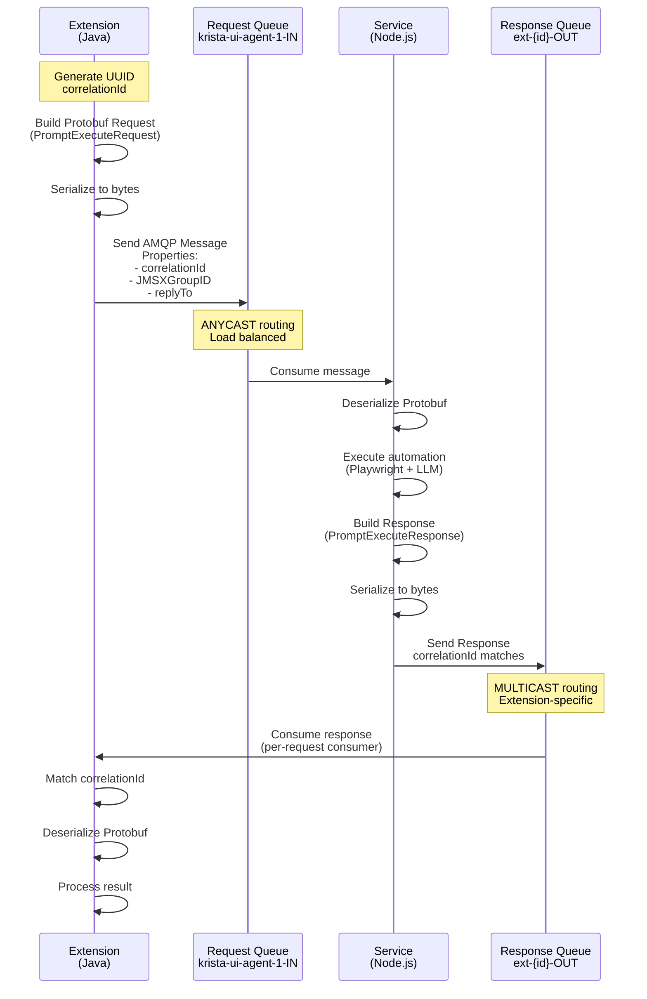

### Queue Architecture

#### Queue Naming Convention

| Queue Type | Pattern | Example | Routing |
|------------|---------|---------|---------|
| **Request Queue** | `krista-ui-agent-{version}-IN` | `krista-ui-agent-1-IN` | ANYCAST (shared) |
| **Response Queue** | `krista-ui-agent-responses-{extensionId}-{version}-OUT` | `krista-ui-agent-responses-ext-inv123-ws456-1-OUT` | MULTICAST (unique) |

#### Queue Lifecycle

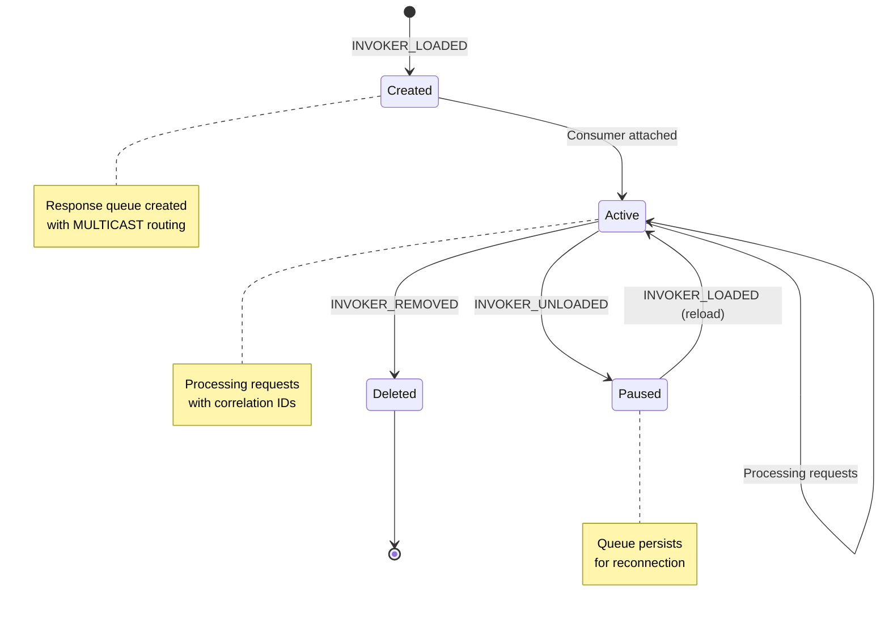

### Correlation ID Tracking

**Purpose:** Match asynchronous responses to their originating requests

**Flow:**
1. Extension generates UUID for each request
2. UUID set as AMQP `correlationId` property
3. Service copies `correlationId` to response message
4. Extension creates per-request consumer filtered by `correlationId`
5. Consumer receives only matching response
6. Consumer auto-closes after receiving response

**Example:**
```java
String correlationId = UUID.randomUUID().toString(); // "a1b2c3d4-..."

// Set in request
message.putStringProperty("correlationId", correlationId);

// Consumer filter
String filter = "correlationId = '" + correlationId + "'";
ClientConsumer consumer = session.createConsumer(responseQueue, filter);
```

### Session Affinity (JMSXGroupID)

**Purpose:** Ensure all requests from same extension instance go to same service instance

**Mechanism:**
- Extension sets `JMSXGroupID` to unique extension ID
- Artemis routes all messages with same group ID to same consumer
- Enables session state management in service

**Example:**
```java
String extensionId = "ext-inv123-ws456";
message.putStringProperty("JMSXGroupID", extensionId);
```

---

## Request Flow Diagrams

### 1. Single Command Mode (PromptExecuteRequest)

**Use Case:** Execute a one-off browser automation task without maintaining session state

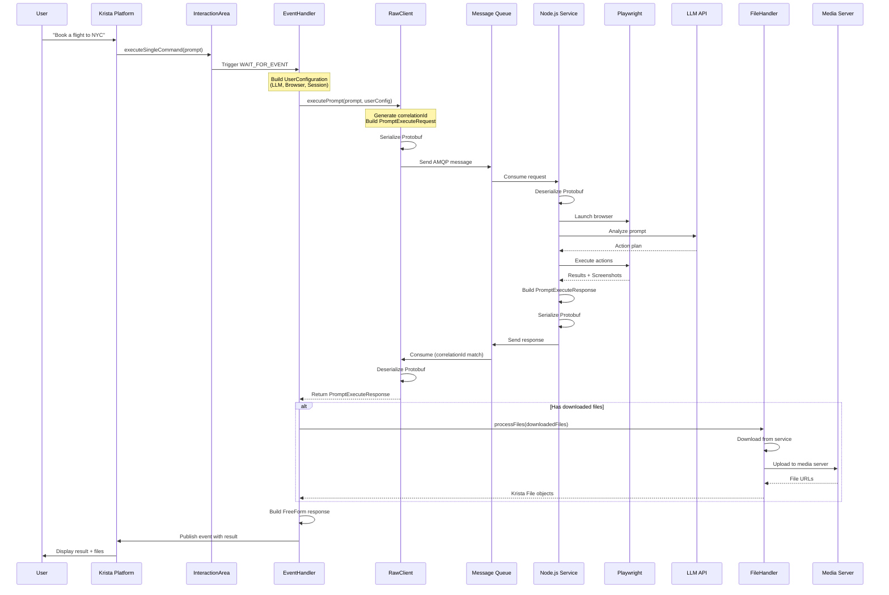

**Key Steps:**

1. **Request Construction** (Extension)
   - Generate unique `requestId` (UUID)
   - Build `UserConfiguration` from extension attributes
   - Create `PromptExecuteRequest` protobuf message
   - Serialize to bytes

2. **Message Sending** (Extension)
   - Set AMQP properties (correlationId, JMSXGroupID, replyTo)
   - Send to request queue
   - Create per-request consumer with correlationId filter
   - Wait for response (20-minute timeout)

3. **Request Processing** (Service)
   - Deserialize protobuf message
   - Launch browser context
   - Send prompt to LLM for action planning
   - Execute browser actions via Playwright
   - Capture screenshots and downloads
   - Build response with results

4. **Response Handling** (Extension)
   - Receive response via correlationId-filtered consumer
   - Deserialize protobuf response
   - Download files from service (HMAC-signed URLs)
   - Upload files to Krista media server
   - Build FreeForm result
   - Publish WAIT_FOR_EVENT completion

---

### 2. Start Interactive Session (SessionStartRequest)

**Use Case:** Create a persistent browser session for multi-step automation

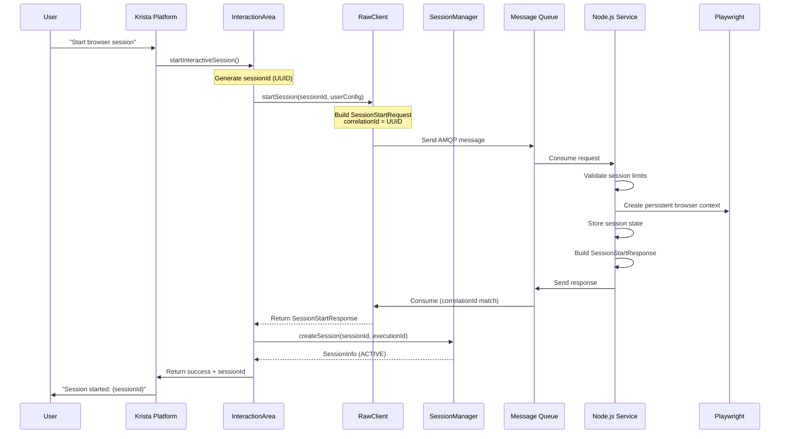

**Key Steps:**

1. **Session Creation** (Extension)
   - Generate unique `sessionId` (UUID)
   - Build `UserConfiguration`
   - Create `SessionStartRequest`
   - Send via AMQP

2. **Session Initialization** (Service)
   - Validate session limits (max concurrent sessions)
   - Create persistent Playwright browser context
   - Store session metadata (sessionId, workspaceId, accountId)
   - Set 24-hour TTL
   - Return session info

3. **Session Tracking** (Extension)
   - Store session in `UiAgentSessionManager`
   - Track state (ACTIVE)
   - Return sessionId to user

---

### 3. Execute Session Steps (SessionExecuteRequest)

**Use Case:** Execute commands within an existing browser session

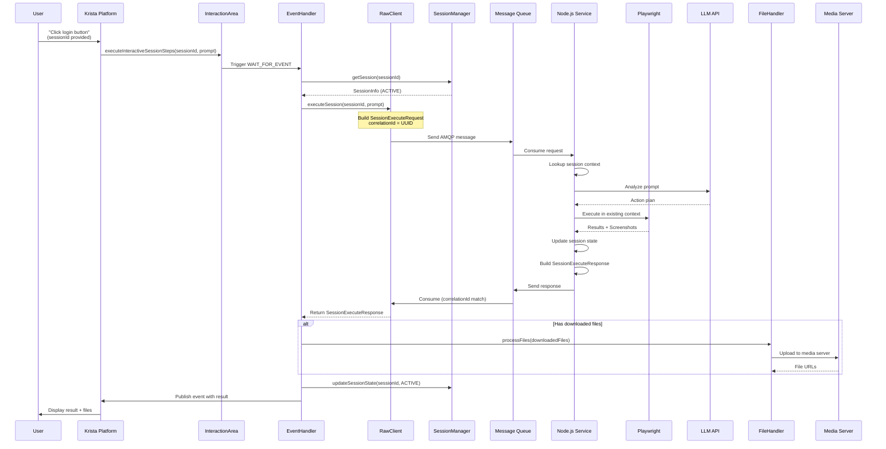

**Key Steps:**

1. **Session Validation** (Extension)
   - Verify session exists in `SessionManager`
   - Check session state (must be ACTIVE)
   - Build `SessionExecuteRequest` with sessionId

2. **Command Execution** (Service)
   - Lookup existing browser context by sessionId
   - Execute command in persistent context
   - Maintain browser state (cookies, localStorage, etc.)
   - Capture results and screenshots

3. **State Update** (Extension)
   - Update session last activity timestamp
   - Process files if any
   - Return results to user

---

### 4. End Interactive Session (SessionCloseRequest)

**Use Case:** Close browser session and cleanup resources

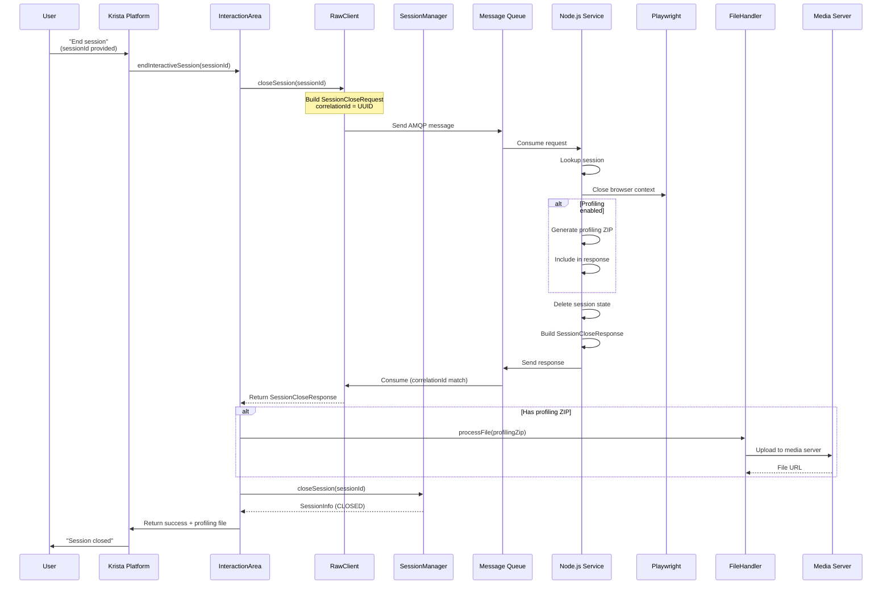

**Key Steps:**

1. **Session Closure** (Extension)
   - Build `SessionCloseRequest` with sessionId
   - Send via AMQP

2. **Resource Cleanup** (Service)
   - Close Playwright browser context
   - Generate profiling ZIP if enabled
   - Delete session from memory
   - Return closure confirmation

3. **State Cleanup** (Extension)
   - Remove session from `SessionManager`
   - Process profiling file if present
   - Return confirmation to user

---

### 5. File Delete Request

**Use Case:** Delete temporary files from service after upload to media server

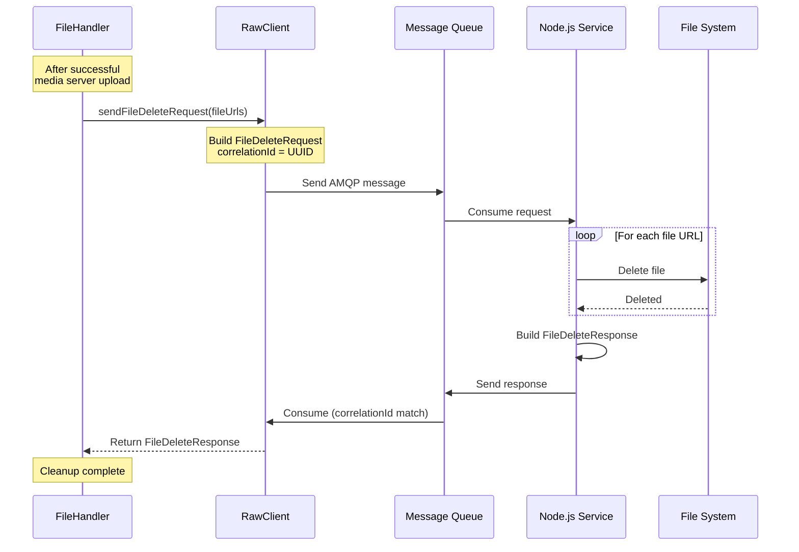

---

## Session Management Architecture

### Session Lifecycle

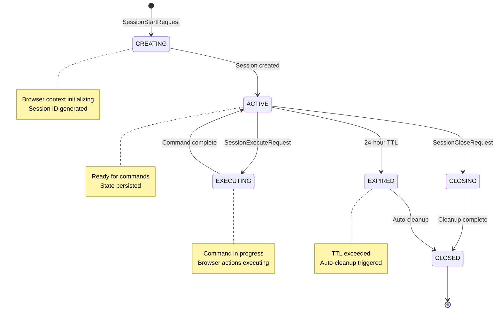

### Session Multiplexing

**Challenge:** Multiple concurrent sessions per conversation

**Solution:** SessionKey = (ConversationId, SessionName)

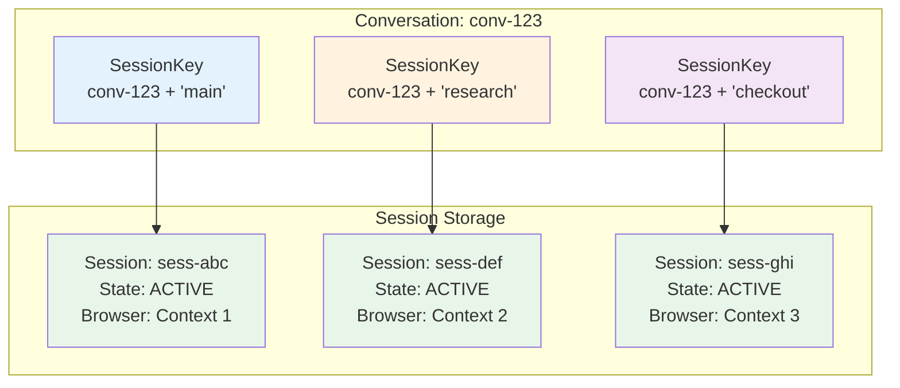

### Session TTL and Expiration

**Configuration:**
- Default TTL: 24 hours
- Configurable via `SessionDefaults.timeout_ms`
- Auto-cleanup on expiration

**Expiration Handling:**

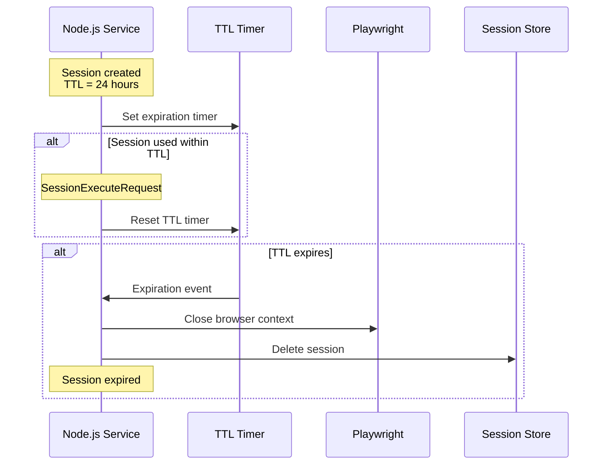

---

## File Handling Architecture

### Complete File Flow

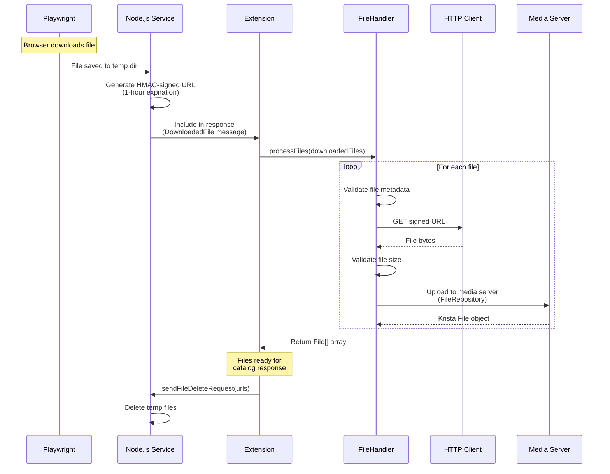

### HMAC URL Signing and Verification

**Purpose:** Secure file downloads with time-limited, tamper-proof URLs

**Signing Process (Service):**

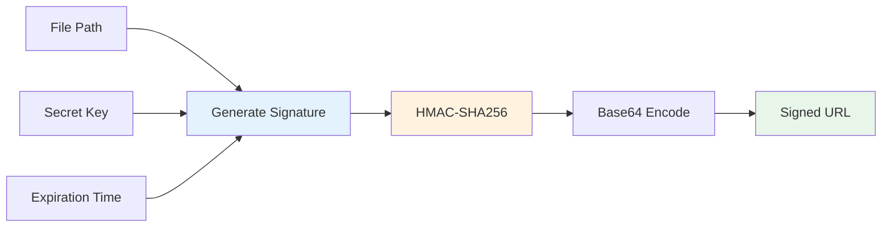

**URL Format:**
```
http://service:3000/files/download?
  path=/tmp/file.pdf&
  expires=1738617600&
  signature=a1b2c3d4e5f6...
```

**Verification Process (Service):**

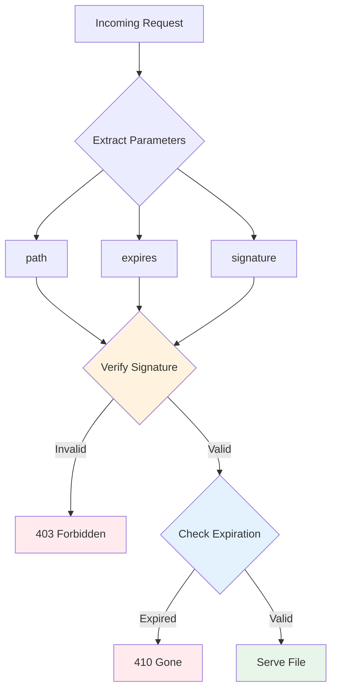

### FileHandlingService Implementation

**Key Methods:**

| Method | Purpose | Flow |
|--------|---------|------|
| `processFiles()` | Process array of downloaded files | Iterate → download → upload → cleanup |
| `processFile()` | Process single file | Download → validate → upload → return File object |
| `downloadFile()` | Download from HMAC URL | HTTP GET → validate size → return bytes |
| `uploadToMediaServer()` | Upload to Krista | FileRepository.upload() → return File |

**Error Handling:**

- **Network errors:** Retry with exponential backoff
- **Size validation:** Reject files > 100 MB
- **HMAC errors:** Log and skip file
- **Upload errors:** Retry up to 3 times

---

## Security Architecture

### Security Layers

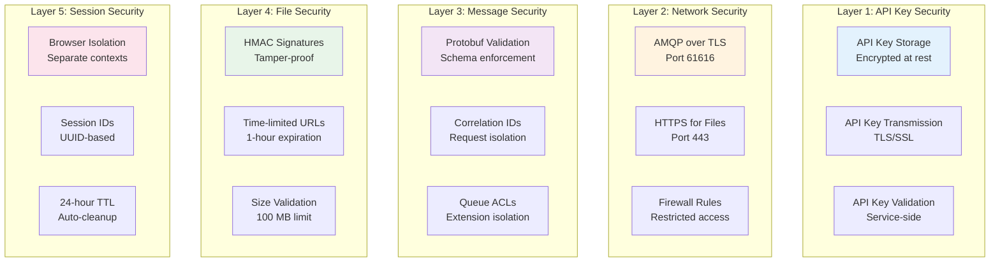

### API Key Management Flow

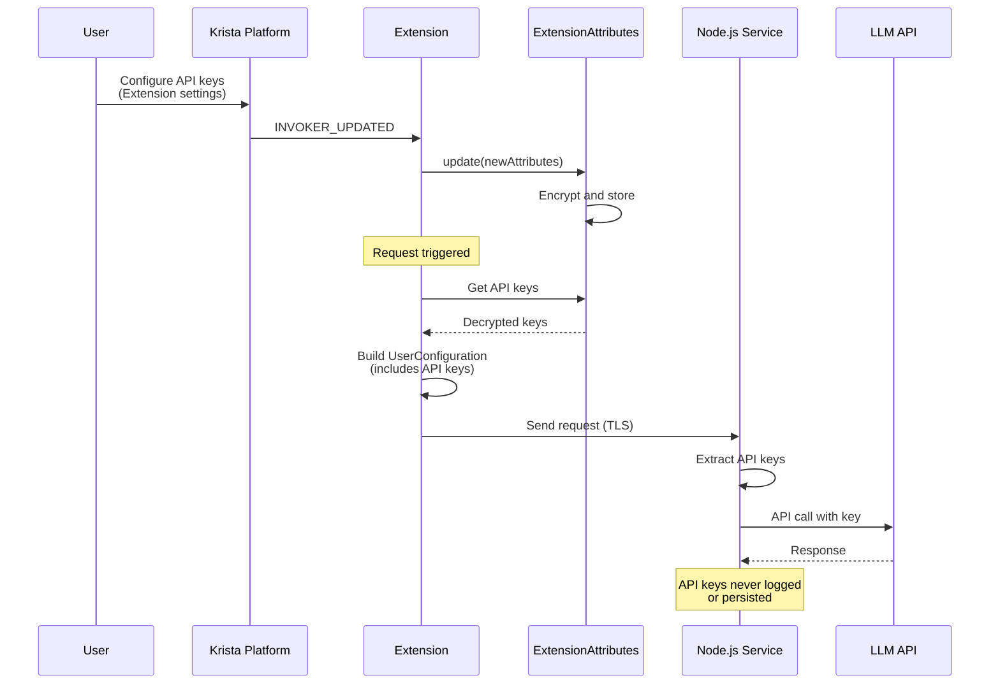

### Access Control

**Queue-Level Isolation:**

| Resource | Access Control | Mechanism |
|----------|---------------|-----------|
| **Request Queue** | Shared (all extensions) | ANYCAST routing |
| **Response Queue** | Extension-specific | Unique queue per extension |
| **Session Data** | Workspace-scoped | workspaceId validation |
| **Files** | Account-scoped | accountId validation |

**Artemis ACL Configuration:**

```xml
<security-setting match="krista-ui-agent-#">
   <permission type="send" roles="krista-extension"/>
   <permission type="consume" roles="krista-extension"/>
   <permission type="createNonDurableQueue" roles="krista-extension"/>
   <permission type="deleteNonDurableQueue" roles="krista-extension"/>
</security-setting>
```

---

## Deployment Architecture

### Deployment Topology

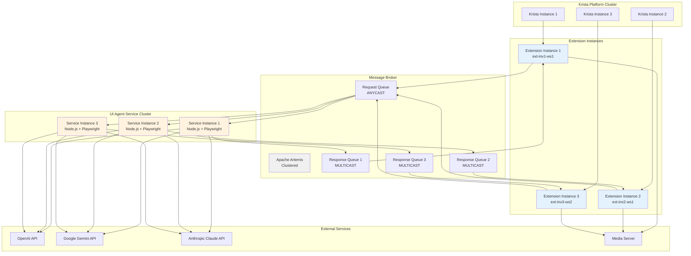

### Horizontal Scaling Architecture

**Extension Side:**
- Each workspace/invoker gets unique extension instance
- Each instance has unique response queue
- No shared state between instances

**Service Side:**
- Multiple Node.js service instances
- Session affinity via JMSXGroupID
- Shared request queue with ANYCAST routing
- Each instance maintains its own session store

**Scaling Characteristics:**

| Component | Scaling Strategy | Limit |
|-----------|-----------------|-------|
| **Extension** | Auto-scaled by Krista | Per workspace/invoker |
| **Service** | Manual horizontal scaling | CPU/Memory bound |
| **Message Broker** | Clustered Artemis | Network bandwidth |
| **LLM APIs** | External rate limits | Provider-specific |

### Service Instance Distribution

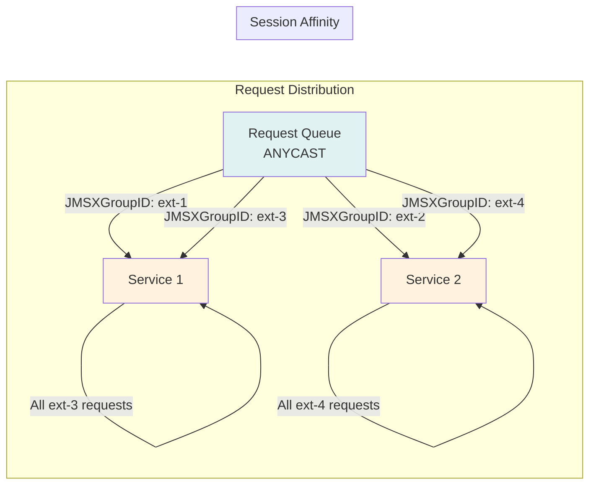

**Benefits:**
- Load balanced across service instances
- Session state maintained per extension
- Fault tolerance (if instance fails, sessions lost but can restart)

---

## Data Flow Diagrams

### End-to-End Data Flow (Single Command)

```mermaid
graph TB
    A[User Input<br/>'Book flight to NYC'] --> B[Krista Platform]
    B --> C[InteractionArea<br/>executeSingleCommand]
    C --> D[EventHandler<br/>WAIT_FOR_EVENT]
    D --> E[Build UserConfiguration<br/>LLM + Browser + Session]
    E --> F[UiAgentRawClient<br/>executePrompt]
    F --> G[Serialize Protobuf<br/>PromptExecuteRequest]
    G --> H[AMQP Message<br/>correlationId + JMSXGroupID]
    H --> I[Request Queue<br/>krista-ui-agent-1-IN]
    I --> J[Node.js Service<br/>Consume message]
    J --> K[Deserialize Protobuf]
    K --> L[Launch Browser<br/>Playwright]
    L --> M[LLM Analysis<br/>Action planning]
    M --> N[Execute Actions<br/>Navigate, click, type]
    N --> O[Capture Results<br/>Screenshots + Downloads]
    O --> P[Build Response<br/>PromptExecuteResponse]
    P --> Q[Serialize Protobuf]
    Q --> R[AMQP Message<br/>correlationId match]
    R --> S[Response Queue<br/>ext-{id}-OUT]
    S --> T[UiAgentRawClient<br/>Receive response]
    T --> U[Deserialize Protobuf]
    U --> V[FileHandlingService<br/>Download files]
    V --> W[Upload to Media Server<br/>FileRepository]
    W --> X[Build FreeForm Result<br/>Text + Files]
    X --> Y[Publish Event<br/>WAIT_FOR_EVENT complete]
    Y --> Z[Krista Platform<br/>Display to user]

    style A fill:#e3f2fd
    style E fill:#fff3e0
    style G fill:#f3e5f5
    style L fill:#e8f5e9
    style M fill:#fce4ec
    style V fill:#fff9c4
    style Z fill:#e3f2fd
```

### Error Handling Flow

```mermaid
graph TB
    A[Request Received] --> B{Validate Request}
    B -->|Invalid| C[Return Error Response<br/>400 Bad Request]
    B -->|Valid| D{Execute Automation}

    D -->|Success| E[Build Success Response]
    D -->|LLM Error| F{Retry with Fallback}
    D -->|Browser Error| G{Retry Action}
    D -->|Timeout| H[Return Timeout Error]

    F -->|Fallback Success| E
    F -->|Fallback Failed| I[Return LLM Error]

    G -->|Retry Success| E
    G -->|Max Retries| J[Return Browser Error]

    E --> K[Serialize Response]
    I --> K
    J --> K
    H --> K
    C --> K

    K --> L[Send to Response Queue]

    style E fill:#e8f5e9
    style I fill:#ffebee
    style J fill:#ffebee
    style H fill:#ffebee
    style C fill:#ffebee
```

### Timeout and Retry Mechanism

```mermaid
sequenceDiagram
    participant Ext as Extension
    participant MQ as Message Queue
    participant Svc as Service
    participant LLM as LLM API

    Ext->>MQ: Send request
    MQ->>Svc: Consume

    Note over Ext: Start 20-min timeout

    Svc->>LLM: Primary model request

    alt Primary model success
        LLM-->>Svc: Response
        Svc->>MQ: Send response
        MQ->>Ext: Receive (within timeout)
    end

    alt Primary model fails
        LLM-->>Svc: Error
        Svc->>LLM: Fallback model request

        alt Fallback success
            LLM-->>Svc: Response
            Svc->>MQ: Send response
            MQ->>Ext: Receive (within timeout)
        end

        alt Fallback fails
            LLM-->>Svc: Error
            Svc->>MQ: Send error response
            MQ->>Ext: Receive error
        end
    end

    alt Timeout expires
        Note over Ext: 20 minutes elapsed
        Ext->>Ext: Throw TimeoutException
        Note over Svc: Response discarded<br/>if arrives late
    end
```

---

## Architecture Patterns Summary

### Key Patterns Used

| Pattern | Purpose | Implementation |
|---------|---------|----------------|
| **Singleton** | Prevent duplicate ESB consumers | `UiAgentRawClient.getInstance()` |
| **Per-Request Consumer** | Parallel request processing | Temporary consumer with correlationId filter |
| **WAIT_FOR_EVENT** | Asynchronous catalog requests | Krista 4.0 pattern for long-running operations |
| **Session Affinity** | Route requests to same service instance | JMSXGroupID in AMQP messages |
| **Correlation ID** | Match async responses to requests | UUID-based request/response tracking |
| **Builder Pattern** | Construct complex protobuf messages | Protobuf generated builders |
| **Repository Pattern** | Abstract file storage | FileRepository for media server |
| **Strategy Pattern** | Multiple LLM providers | Provider-specific configurations |

### Design Trade-offs

| Decision | Benefit | Trade-off |
|----------|---------|-----------|
| **Google Protobuf** | Type safety, schema validation | More complex than JSON |
| **Per-Request Consumers** | Parallel processing | More network overhead |
| **Session Affinity** | Stateful sessions | Uneven load distribution |
| **HMAC-Signed URLs** | Secure file downloads | 1-hour expiration window |
| **24-Hour Session TTL** | Automatic cleanup | Sessions expire if unused |
| **Singleton ESB Client** | Prevent duplicate consumers | Shared state (thread-safe) |

---

## Component Interaction Matrix

### Request Type vs Components

| Request Type | InteractionArea | EventHandler | RawClient | SessionManager | FileHandler |
|--------------|----------------|--------------|-----------|----------------|-------------|
| **Single Command** | ✅ Entry point | ✅ WAIT_FOR_EVENT | ✅ executePrompt() | ❌ Not used | ✅ Process files |
| **Start Session** | ✅ Entry point | ❌ Direct call | ✅ startSession() | ✅ createSession() | ❌ Not used |
| **Execute Session** | ✅ Entry point | ✅ WAIT_FOR_EVENT | ✅ executeSession() | ✅ updateState() | ✅ Process files |
| **End Session** | ✅ Entry point | ❌ Direct call | ✅ closeSession() | ✅ closeSession() | ✅ Profiling ZIP |
| **File Delete** | ❌ Not involved | ❌ Not involved | ✅ sendFileDeleteRequest() | ❌ Not used | ✅ Trigger cleanup |

### Message Flow by Request Type

```mermaid
graph LR
    subgraph "Single Command"
        SC1[InteractionArea] --> SC2[EventHandler]
        SC2 --> SC3[RawClient]
        SC3 --> SC4[Service]
        SC4 --> SC3
        SC3 --> SC2
        SC2 --> SC5[FileHandler]
    end

    subgraph "Start Session"
        SS1[InteractionArea] --> SS2[RawClient]
        SS2 --> SS3[Service]
        SS3 --> SS2
        SS2 --> SS4[SessionManager]
    end

    subgraph "Execute Session"
        ES1[InteractionArea] --> ES2[EventHandler]
        ES2 --> ES3[RawClient]
        ES3 --> ES4[Service]
        ES4 --> ES3
        ES3 --> ES2
        ES2 --> ES5[FileHandler]
        ES2 --> ES6[SessionManager]
    end

    subgraph "End Session"
        EN1[InteractionArea] --> EN2[RawClient]
        EN2 --> EN3[Service]
        EN3 --> EN2
        EN2 --> EN4[SessionManager]
        EN2 --> EN5[FileHandler]
    end

    style SC1 fill:#e3f2fd
    style SS1 fill:#fff3e0
    style ES1 fill:#f3e5f5
    style EN1 fill:#e8f5e9
```

---

## Performance Characteristics

### Latency Breakdown

| Operation | Typical Latency | Components |
|-----------|----------------|------------|
| **AMQP Message Send** | 5-10 ms | Extension → Broker |
| **AMQP Message Receive** | 5-10 ms | Broker → Service |
| **Protobuf Serialization** | 1-2 ms | Extension/Service |
| **Browser Launch** | 500-1000 ms | Playwright |
| **LLM API Call** | 1-5 seconds | OpenAI/Gemini/Claude |
| **Browser Action** | 100-500 ms | Playwright |
| **File Download** | 100-1000 ms | HTTP |
| **Media Server Upload** | 200-2000 ms | FileRepository |
| **Total (Single Command)** | 2-10 seconds | End-to-end |

### Throughput Estimates

| Metric | Value | Notes |
|--------|-------|-------|
| **Requests/Second (per service instance)** | 2-5 | LLM API rate limited |
| **Concurrent Sessions (per service instance)** | 10-20 | Memory/CPU bound |
| **Max File Size** | 100 MB | Configurable |
| **Max Session Duration** | 24 hours | TTL |
| **Message Queue Depth** | 1000+ | Artemis capacity |

---

## Monitoring and Observability

### Key Metrics to Monitor

```mermaid
graph TB
    subgraph "Extension Metrics"
        EM1[Request Count<br/>by type]
        EM2[Request Duration<br/>p50, p95, p99]
        EM3[Error Rate<br/>by type]
        EM4[Active Sessions<br/>count]
    end

    subgraph "Service Metrics"
        SM1[Browser Pool<br/>active/idle]
        SM2[LLM API Latency<br/>by provider]
        SM3[File Processing<br/>count/size]
        SM4[Memory Usage<br/>heap/RSS]
    end

    subgraph "Queue Metrics"
        QM1[Queue Depth<br/>request/response]
        QM2[Message Rate<br/>in/out]
        QM3[Consumer Count<br/>active]
        QM4[Dead Letter Queue<br/>count]
    end

    subgraph "Business Metrics"
        BM1[Automation Success Rate<br/>%]
        BM2[Session Completion Rate<br/>%]
        BM3[File Upload Success<br/>%]
        BM4[User Satisfaction<br/>feedback]
    end

    style EM1 fill:#e3f2fd
    style SM1 fill:#fff3e0
    style QM1 fill:#f3e5f5
    style BM1 fill:#e8f5e9
```

### Logging Strategy

**Extension Side (Java):**
```java
log.info("Executing prompt: requestId={}, correlationId={}", requestId, correlationId);
log.debug("Request details: {}", request);
log.error("Failed to execute prompt: {}", e.getMessage(), e);
```

**Service Side (Node.js):**
```javascript
logger.info('Processing request', { requestId, sessionId, correlationId });
logger.debug('LLM response', { model, tokens, latency });
logger.error('Automation failed', { error, requestId, sessionId });
```

**Correlation ID Tracking:**
- Extension generates UUID
- Logged in all extension log statements
- Passed to service via AMQP
- Logged in all service log statements
- Enables end-to-end request tracing

---

## Appendix: Technology Versions

| Technology | Version | Purpose |
|------------|---------|---------|
| **Java** | 21 | Extension runtime |
| **Krista Framework** | 4.0 | Extension framework |
| **Gradle** | 8.x | Build tool |
| **Apache Artemis** | 2.x | Message broker |
| **Google Protobuf** | 3.25.1 | Serialization |
| **Node.js** | 20.14.0 | Service runtime |
| **Playwright** | Latest | Browser automation |
| **OpenAI API** | Latest | GPT-4 models |
| **Google Gemini API** | Latest | Gemini models |
| **Anthropic API** | Latest | Claude models |

---

## Appendix: Queue Configuration Reference

### Request Queue

```
Name: krista-ui-agent-1-IN
Type: ANYCAST
Durable: true
Auto-delete: false
Max consumers: unlimited
Routing: Round-robin across consumers
```

### Response Queue

```
Name: krista-ui-agent-responses-{extensionId}-1-OUT
Type: MULTICAST
Durable: false
Auto-delete: true
Max consumers: unlimited (per-request consumers)
Routing: All messages to all consumers (filtered by correlationId)
```

### AMQP Message Properties

| Property | Type | Purpose | Example |
|----------|------|---------|---------|
| `correlationId` | String | Request/response matching | `a1b2c3d4-e5f6-...` |
| `JMSXGroupID` | String | Session affinity | `ext-inv123-ws456` |
| `replyTo` | String | Response queue address | `krista-ui-agent-responses-ext-inv123-ws456-1-OUT` |
| `_AMQ_DUPL_ID` | String | Duplicate detection | Same as correlationId |

---

## Document Revision History

| Version | Date | Changes | Author |
|---------|------|---------|--------|
| 1.0 | 2026-02-03 | Initial comprehensive architecture document | AI Assistant |

---

**End of Architecture Document**


